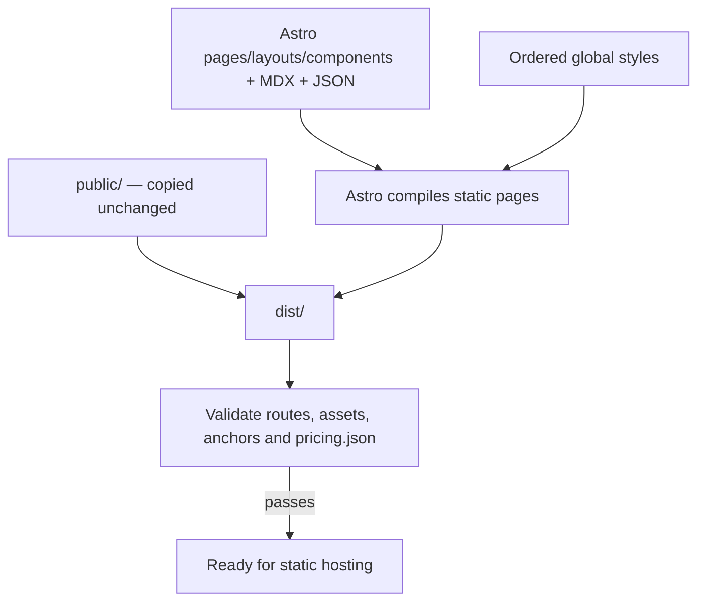

# Snippets website

The Snippets homepage, documentation, pricing and legal pages, built with Astro.
The production site is static HTML, CSS, local fonts and media. There is **no
browser JavaScript** in the published build. Astro and MDX run at build time;
the development server uses JavaScript for live updates while you work.

Technical explanations: [the build](#how-the-build-works),
[the remaining scripts](#why-these-scripts-remain),
[light/dark mode](#how-light-and-dark-mode-work),
[the unfolding note](#how-the-note-unfolds), and
[scroll reveals](#how-scroll-reveals-work).

## Develop

Requires Node.js **22.23.4 or newer** and pnpm 10.26.2.

```sh
pnpm install --frozen-lockfile
pnpm dev
```

Open http://127.0.0.1:64530/. Astro watches the source and updates the browser as
files change. The dev server sends `Cache-Control: no-store`. Port `64530` is
configured in `astro.config.mjs`; if it is occupied, dev exits instead of silently
choosing another port. Stop an old preview process before starting this one.
Pass `--port 64531` to use a different port temporarily.

```sh
pnpm build       # Astro production build, followed by output checks
pnpm check       # validate the existing dist/ without rebuilding
pnpm preview     # serve the production build, default port 64530
pnpm media:build # optional: regenerate screenshots and the note atlas
```

Astro may run dev/preview in the background when launched by an AI coding agent;
its `--ignore-lock` option keeps agent-run QA sessions in the foreground. Stop
background sessions with `pnpm exec astro dev stop` or
`pnpm exec astro preview stop`. Ordinary terminal development does not require
these options.

## Organization

| Location | Purpose |
| --- | --- |
| `astro.config.mjs` | Static output, domain, port, Markdown configuration, old-route redirects and sitemap |
| `src/pages/` | Homepage, pricing, privacy, terms, 404 and docs routes |
| `src/components/home/` | The intro, note, ten homepage sections, icons and footer |
| `src/components/` | Shared header, theme toggle, icons, docs media and pricing components |
| `src/layouts/` | Shared document metadata, legal layout and documentation layout |
| `src/content/docs/` | The 17 MDX articles, with title/description/draft metadata |
| `src/data/doc-navigation.json` | Article grouping and order |
| `src/data/docs.js` | Astro imports of article metadata/content, navigation validation and reading-time estimates |
| `src/data/release.json` | Release version used in download links |
| `src/styles/` | Existing global styles, including CSS-only scroll and theme behavior |
| `src/lib/styles.js` | Explicit stylesheet order for each layout |
| `src/lib/rehype-docs.mjs` | Markdown heading links and code/table presentation wrappers |
| `public/assets/` | Published fonts, note atlas, light/dark screenshots and documentation media |
| `public/pricing.json` | Canonical pricing data, served unchanged at `/pricing.json` |
| `public/CNAME`, `public/.nojekyll`, `public/robots.txt` | Static hosting and crawler configuration |
| `media/` | Original homepage screenshot PNGs, note frames and theme reference |
| `scripts/` | Output validation and optional media generation |
| `dist/` | Generated production files; ignored by Git |
| `.astro/` | Generated Astro metadata and types; ignored by Git |

## How the build works

`pnpm build` runs `astro build`, then `node scripts/check.mjs`.



Astro resolves the components and layouts while building. They do not become
browser components, introduce extra wrapper elements, or require hydration.
The homepage's section components output the same HTML structure as before.
All scroll effects continue to use the existing CSS timelines and transitions.

The shared document layout adds canonical URLs, page titles and descriptions.
Astro generates the documentation routes from the MDX modules and renders pricing
from the same JSON file that external consumers receive. Privacy and terms remain
plain authored markup inside lightweight Astro pages with a shared layout.

`src/lib/styles.js` imports each stylesheet with `?url` and passes an ordered
list to the document layout. Vite emits shared CSS files with content hashes in
their filenames. Explicit links preserve the existing cascade order, including
brand overrides, encryption styles and the theme palette. The CSS stays global;
section components do not add scoped styles or change the animation selectors.
Asset URLs inside CSS are rooted at `/assets/` so they work from both dev and
hashed production stylesheet URLs.

HTML compression and CSS minification are disabled deliberately. HTML compression
can remove spaces between inline heading phrases. The CSS minifier can fold
`animation-timeline` into a shorthand that browsers reject, breaking scroll
animations. Versioned CSS assets and static output are still generated normally.

Astro's MDX integration handles Markdown compilation and Prism code highlighting.
The small rehype plugin adds our heading links, code panels and table wrappers.
`Figure.astro`, `DocVideo.astro`, `Row.astro` and `Callout.astro` provide
article-specific presentation. This replaces the former custom React renderer.
The original article URLs and heading anchors are preserved. Four unfinished
guides continue to show their existing “Guide in progress” presentation.

The sitemap integration generates `sitemap-index.xml` and `sitemap-0.xml`.
Old `/dark/…` URLs are static redirects to the normal pages; `/showcase/`
redirects to the homepage features. These compatibility pages do not duplicate
content. Light and dark modes share one HTML document per page.

`public/pricing.json` stays at exactly **`/pricing.json`**, separate from
`/pricing/`. Keep its existing fields, including fields the current pricing UI
does not display. The checker compares the published file byte for byte against
its source.

The build produces no server bundle to run in production. The host serves `dist/`
directly. Unlike the retired custom staging/swap script, Astro rebuilds `dist/`
directly; use `pnpm dev` while editing. A failed CI build prevents publishing.

## Why these scripts remain

Astro now owns development, page generation, asset versioning and redirects.
The previous `build.mjs`, `build-docs.mjs`, `build-pricing.mjs`,
`finalize.mjs`, `dev.mjs` and `serve.mjs` are removed.

| Script | Why it remains |
| --- | --- |
| [check.mjs](scripts/check.mjs) | Checks the actual output: required pages, local links/assets/anchors, native theme controls, old-route redirects, public pricing JSON, and absence of browser scripts/build source |
| [build-media.mjs](scripts/build-media.mjs) | Optional conversion of original screenshot PNGs into the checked-in WebPs |
| [build-note.mjs](scripts/build-note.mjs) | Optional assembly of the supplied frames into the CSS sprite atlas |
| [paths.mjs](scripts/paths.mjs) | Shared filesystem locations for those maintenance scripts; it does not run a build |

`pnpm check` is our output validator, not Astro's optional TypeScript diagnostic
command. It checks local references, not the availability of external websites.
No custom preview server or server-test suite is needed now that Astro serves the
site. The production-output checks still run on every build.

## How light and dark mode work

Each header uses `src/components/ThemeToggle.astro`, a native checkbox styled as a sun/moon button. No browser
JavaScript or page navigation is involved:

1. `prefers-color-scheme` selects the device's preferred theme on a fresh page.
2. CSS `:has(#theme-toggle:checked)` reverses that preference while the checkbox
   is checked. Clicking again returns to the system preference.
3. `color-scheme` selects the light or dark values in `light-dark()` color tokens.
   Both palettes live together in `src/styles/themes.css`.
4. A named style container query applies the remaining dark component treatments
   and shows the appropriate screenshot and sun/moon icon. Its explicit name
   keeps it separate from the homepage's scroll-animation containers.

Homepage screenshot pairs are written in the section components. For docs,
`Figure.astro` includes a dark image when the source has one, including a matching
full-size image link. CSS hides the inactive variant with `display: none`, removing
it from layout and the accessibility tree. Each image keeps its own dimensions.
Images without a dark counterpart stay the same. Both variants may be downloaded;
CSS visibility is not a guarantee of avoiding an image request.

The native checkbox supports keyboard activation, with a visible focus ring. Theme
switching stays on the same page, preserving the current URL and running scroll
animations. Printing uses the light palette.

**CSS does not store a manual choice across pages.** A newly opened page follows
the device preference again; browser back/forward restoration can retain form
state. Persisting a chosen theme across navigation would need a small browser
script or a server-side preference. The current implementation keeps the HTML/CSS
only constraint. It targets modern browsers supporting `:has()`, `light-dark()`
and custom-property style queries.

## How the note unfolds

The opening note is a **sprite atlas**: one static image containing every pose in
a grid. The browser displays one cell at a time. It does not play an animated WebP
or seek through a video.

### Preparing the frames

[scripts/build-note.mjs](scripts/build-note.mjs) reads the 90 PNGs and manifest in
`media/note/porcelain/`. The supplied sequence runs from open to flat, so the
builder reads frames `0089` through `0000` to make playback start flat and end open.
It resizes each frame to 480 × 480 pixels, places them in a 10-column × 9-row grid,
and encodes the resulting 4800 × 4320 image as `note-opening-90.webp`. It also creates
`note-open.webp`, a 160px static icon, from the final playback frame.

Those outputs are checked into `public/assets/note/`. A normal page build copies
them; it does not render or re-encode the note each time.

### Selecting a pose with scroll

The relevant markup is `.note-mover > .note-sprite` in
[src/pages/index.astro](src/pages/index.astro). In
[src/styles/main.css](src/styles/main.css), `.note-sprite` uses the atlas as its
background, with `background-size: 1000% 900%`. The element therefore shows one
of the ten-by-nine cells. `@keyframes unfold-note` specifies 90 background positions.

```css
animation: unfold-note steps(1, end) both;
animation-timeline: scroll(root block);
animation-range: 0px var(--unfold-end);
```

The root scroll position supplies the animation's progress. `steps(1, end)` makes
each keyframe interval jump straight to the next cell, avoiding a slide across
adjacent frames in the atlas. `both` holds the initial/final values outside the
animation range. Stopping scrolling holds the current pose; scrolling upward
selects earlier poses. There is no playback clock or fixed frames-per-second rate.

CSS [animation timelines](https://developer.mozilla.org/en-US/docs/Web/CSS/Reference/Properties/animation-timeline)
provide the scroll progress, and
[animation ranges](https://developer.mozilla.org/en-US/docs/Web/CSS/Reference/Properties/animation-range)
limit which part of that progress controls an effect.

### Opening, docking and revealing the homepage

The current choreography uses distances in `svh`: one unit is 1% of the small
viewport height. For example, with an 800px small viewport, `85svh` is 680px of
scrolling. These are distances from the top, not percentages of the entire page.
Images loading farther down the page therefore do not shift the intro's endpoints.

| Scroll distance | What changes |
| --- | --- |
| `0 → 85svh` | The atlas advances from flat to fully open |
| `50 → 85svh` | The scroll cue and intro footnote fade away |
| `62 → 85svh` | “It starts with a note” fades and rises out before the main copy arrives |
| `85 → 145svh` | The open note moves to the top-left header position and shrinks to a 60px element |
| `85 → 145svh` | The homepage content fades in, the hero rises 64px, and the shared background blends from paper to white |
| `135 → 145svh` | The navigation header fades into view |

`.note-mover` handles the position and size; its child `.note-sprite` handles the
pose. The open sprite remains fixed in the header after docking. The ordinary
wordmark image is hidden in this enhanced mode, so two icons do not overlap.
The main slogan has its own phrase reveal, gated until both the intro is leaving
and the slogan has reached its entrance position.

The shared background animates a percentage, `--intro-mix`, from 0% to 100%.
`color-mix()` uses that percentage to blend the current theme's paper and white
colors. Keeping the colors outside the keyframes lets a theme switch update them
immediately without restarting the scroll animation.

To tune the opening distance, change `--unfold-end`. To slow the docking relative
to scrolling, increase the interval between `--dock-start` and `--dock-end`.
Changing a time duration does not slow this scroll-controlled movement.

Smoothness is limited by the number of distinct poses. A longer source video with
the same frames adds no detail. Changing the frame count requires coordinated
changes to the builder's validation/grid and the CSS positions and background size;
the media builder does **not** regenerate the CSS keyframes automatically.

## How scroll reveals work

There are two different controls: **scroll progress** determines a value continuously,
whereas a **scroll threshold** changes a state and lets a timed transition run.
The note uses the former. Headings, sync cards and diagram details use the latter.
General content reveals have a scroll-controlled fallback and a timed enhancement.

### Paragraphs, screenshots and content groups

The reveal selectors in [src/styles/main.css](src/styles/main.css) cover the
feature copy, screenshot figures and other content groups. They animate `opacity`
and `translateY`: an element starts slightly lower and moves to its normal position
as it becomes visible. No extra screenshot zoom or frame-growth effect is applied.

`view(block)` measures an element's passage through the viewport. The default
range is `entry 16svh` to `entry 33svh`: it starts after the element has travelled
16 small-viewport-height units into view, and completes after 33. This is not
“33% of the whole page.” Scrolling back across that range reverses this fallback.

Where the browser supports [native animation triggers](https://drafts.csswg.org/animation-triggers-1/#triggered-animations),
`timeline-trigger` / `animation-trigger` start a timed reveal that can finish even
when scrolling stops: normally 1100ms
for copy and 1250ms for screenshots. A second scroll animation drives the registered
numeric property `--entry-progress`, which supplies a minimum visible fraction.
Fast scrolling can therefore bring content fully into view sooner. The trigger
uses `replay reset` to replay on entry and reset on leaving its configured range;
this is different from continuously reversing the fallback's progress.

Text rises 64px and images 84px on desktop. At widths up to 700px, these distances
become 32px and 48px. Feature screenshot figures have a 110ms entrance delay on
desktop and no extra delay on mobile.

### Headings resolve phrase by phrase

The current effect operates on authored **phrases**, not individual characters.
A heading has `.phrase-reveal`; each `.heading-phrase` span has `--phrase-order`.
An `aria-label` supplies the complete heading to assistive technology, while the
decorative phrase spans are marked `aria-hidden`.

A one-pixel-wide view-timeline range at `entry 22svh` switches `--heading-state`
from `waiting` to `visible`. A named container exposes that state to its children:

```css
@container phrase-heading style(--heading-state: waiting) {
  /* Phrases are transparent, displaced downward and blurred here. */
}
```

This is a [container style query](https://developer.mozilla.org/en-US/docs/Web/CSS/Guides/Containment/Container_size_and_style_queries):
it checks a CSS custom property's computed value on an ancestor. When the state
becomes visible, the waiting styles stop applying and ordinary CSS transitions
bring the phrases into focus. Scroll only flips the state; elapsed time controls
the reveal after that, so pausing the scroll does not freeze half-resolved text.

The main heading settings are a 200ms lead-in, then 300ms between phrase starts.
Each phrase fades in over 280ms, rises 12px over 620ms, and resolves 7px of blur
over 1000ms. The starts are staggered, but their longer focus transitions overlap.
Feature subheadings use a 220ms stagger, a 10px rise and 4px blur; mobile also
reduces the main blur to 4px.

`.heading-group` keeps a heading and its small label on the same state. Scrolling
upward past the threshold restores `waiting`: all phrases and the label fade and
move down together, using an 80ms settle delay and 240ms transition. They do not
unwind phrase by phrase in reverse order. A small scroll-direction change that
does not cross the threshold does not replay the animation.

### Sync cards and the encryption diagrams

The four `.sync-option` wrappers use the same threshold/state technique at
`entry 18svh`. Their child articles transition in with a 120ms stagger, using
`--sync-order`. On mobile, the order resets for the second two-card row. Each
wrapper follows its own position in the viewport, and exiting clears the stagger
so cards can leave promptly.

In [src/styles/encryption.css](src/styles/encryption.css), each comparison scene
switches `--diagram-state` at `entry 18svh`. The reveal is broken into individual
parts: row backgrounds, labels, device icons, notes, connecting lines, provider
icons, binary chunks and the outcome text. Opacity and transforms introduce the
parts; `clip-path` reveals lines and code. One small packet moves along the
connection to suggest syncing. These are decorative animations, not a live
encryption operation.

Delays run from the initial row through the supporting explanation at 2000ms;
the outcome labels start at 1380ms so the message appears before every detail has
finished. Crossing back into `waiting` gives the parts a unified 240ms exit,
rather than telling the story backwards.

### Browser support and reduced motion

Visible, static content is the base layout. Motion is added inside `@supports`
and `prefers-reduced-motion: no-preference` rules. Without scroll timelines, the
large opening intro is skipped and the normal header/homepage remain available.
Without native animation triggers, general content uses the scroll-controlled
fallback described above. The phrase/card/diagram effects also depend on container
style queries; without those queries, their waiting styles do not hide the content.

With reduced motion enabled, the intro is skipped, transitions/animations are
disabled, and smooth anchor scrolling becomes immediate. Focus rules also reveal
interactive groups for keyboard navigation. Native trigger support is an optional
enhancement, so the exact choreography can differ between browsers. There is no
JavaScript observer, scroll handler or compatibility polyfill in the page.

## Updating media

Edit documentation images/videos directly in `public/assets/docs/`. Folder-based
screenshots use `light.png` and an optional `dark.png`; the Figure component
reads each image's dimensions at build time and renders the appropriate theme pair.

For homepage screenshot changes, update the originals under
`media/screenshots/<name>/{light,dark}.png`, then run `pnpm media:build`.
Update the dimensions in the relevant homepage component if an image changes size.
The media command requires ImageMagick (`magick`) and WebP's `cwebp` locally;
normal builds use the checked-in WebPs and do not need either tool.

Note frames live in `media/note/porcelain/png/`, with a manifest beside them.
The builder requires the current 90-frame sequence and writes
`public/assets/note/note-opening-90.webp` and `note-open.webp`.
If frame count, cell size or atlas layout changes, update the CSS frame mapping
as explained above. The Carbon source frames remain available as source material;
both color themes use the approved Porcelain atlas.

## Publishing

The GitHub workflow installs with the frozen pnpm lockfile and runs `pnpm build`.
Only a successful push build on `main` publishes `dist/` to `gh-pages` using
the existing deployment credential. The `astro-migration` branch, the previous
homepage branch, and pull requests build without publishing.

The custom domain is `snippets.ch`, configured in Astro and `public/CNAME`.
There is no repository-path prefix or production Node server.
