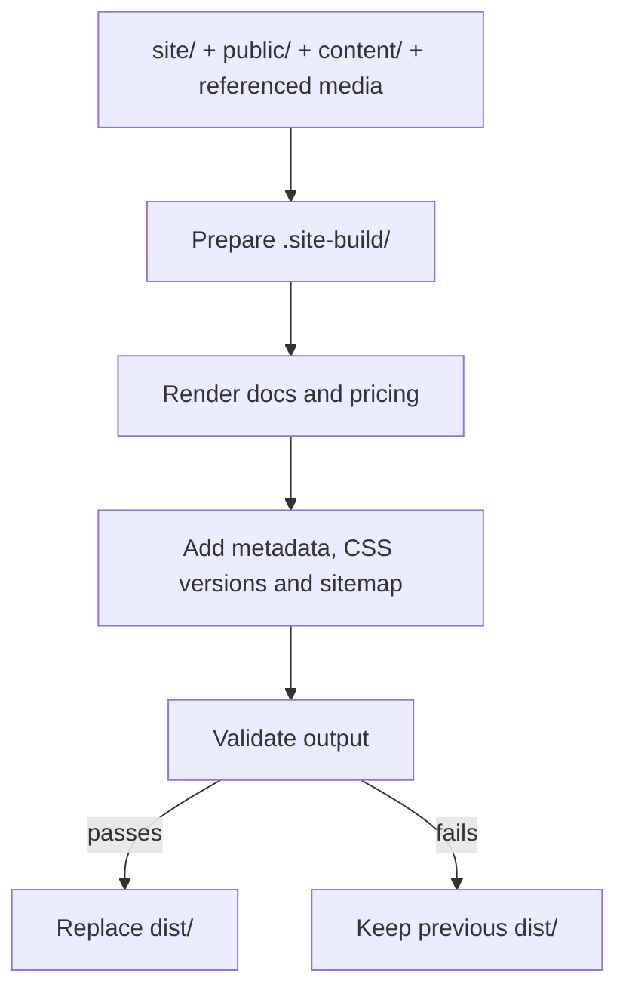

# Snippets website

The redesigned Snippets homepage, documentation, pricing and legal pages. The
published site is HTML, CSS and local media only, with no browser JavaScript.
React and MDX are used **only at build time** to render the documentation.
Node runs the build and local preview tools.

Technical explanations: [the build](#how-the-build-works),
[why several build scripts](#why-several-build-scripts),
[the unfolding note](#how-the-note-unfolds), and
[scroll reveals](#how-scroll-reveals-work).

## Develop

Requires Node.js 22+ and pnpm 10.26.2. The preview server uses Node's built-in
HTTP and filesystem modules; no additional runtime or server package is needed.

```sh
pnpm install --frozen-lockfile
pnpm dev
```

Open http://127.0.0.1:64530/. Both development and preview default to port `64530`.
To override it, pass `--port <number>`; `--port 0` chooses an available port.
The development command rebuilds when source files change; refresh the browser
to see the result. Responses use `Cache-Control: no-store`. A failed build keeps
the last successful preview available.

```sh
pnpm build                 # clean build plus route/asset checks
pnpm check                 # validate the current dist/ again
pnpm test                  # check local preview HTTP behavior
pnpm preview             # serve an existing build on port 64530, without watching
```

## Organization

| Location | Purpose |
| --- | --- |
| `site/index.html` | Authored homepage, including the scroll choreography markup |
| `site/privacy/index.html`, `site/terms/index.html` | Complete, editable HTML pages; no page-specific generator |
| `site/styles/` | Homepage, shared brand, themes, docs, pricing and legal CSS |
| `site/assets/` | Served fonts, note atlas, optimized homepage screenshots |
| `content/docs/` | The 17 documentation articles (MDX); custom components are provided by the builder |
| `public/pricing.json` | Shared pricing data, served unchanged at `/pricing.json` and used to generate the pricing page |
| `content/release.json` | App version used in homepage download links |
| `media/` | Original screenshots, docs media and note frames; builders copy or derive only the required assets |
| `public/` | Files copied unchanged to the site root, including CNAME and .nojekyll |
| `scripts/` | Build, media maintenance, validation and local preview tools |
| `dist/` | Generated, ignored output; the only directory to publish |

Edit the sources above, never generated files in `dist/`.

## How the build works

There is one normal build command: `pnpm build`. Its entry point is
[scripts/build.mjs](scripts/build.mjs). It generates files ahead of time, so the
host serves finished files instead of rendering pages on each request.



The steps run sequentially:

1. Copy the authored homepage, privacy, terms and 404 pages, CSS, runtime assets and
   public files into a temporary staging directory. Fill the homepage download
   URLs from `content/release.json`. Copy `public/pricing.json` to `/pricing.json`.
2. Render the MDX articles to HTML using React on Node, with syntax highlighting
   and referenced documentation media. Generate the pricing page from the same
   `public/pricing.json` that is served to external consumers.
3. Add canonical URLs, a sitemap, redirects and content hashes on stylesheet URLs.
   The hashes change when CSS changes, so deployed styles do not stay stale.
4. Check that the required pages exist and local links, anchors and assets resolve,
   and that no browser JavaScript or build source slipped into the output.
5. Replace `dist/` only after all steps pass. If the build fails, the previous
   successful output remains available.

The page generators write into `.site-build/`, selected through
`SNIPPETS_BUILD_DIR` in [scripts/paths.mjs](scripts/paths.mjs). After validation,
the orchestrator moves the old output to `.dist-previous/`, installs the new
`dist/`, and removes the old copy. If installing the new directory fails, it
attempts to restore the previous one. This keeps failed generation or validation
from replacing a working site; it is not a production deployment transaction.

CSS versioning means a reference such as `styles/main.css?v=<hash>`. The hash is
derived from the stylesheet's bytes. Changed CSS therefore gets a different URL;
the actual CSS filename stays the same. Separately, the local preview sends
`Cache-Control: no-store`, so refreshing reads the latest output.

`pnpm dev` builds once, starts the Node preview server, and watches `site/`,
`content/`, `scripts/` and `public/`. It groups rapid changes with a 180ms debounce
and queues another build if an edit arrives during a build. These are full builds,
not incremental compilation. Refresh the browser after a successful rebuild;
there is no browser script for automatic reload. Direct edits under `media/` are
not watched: run the appropriate media command and/or `pnpm build` afterward.

`pnpm preview` only serves an existing `dist/`, without building or watching.
Avoid running a manual build at the same time as the development watcher:
separate build processes currently share the same staging directory.

The published result is static HTML, CSS, fonts and media. React and Node do their
work during the build; the deployed site needs no application server or hydration.

Every page has one URL and one HTML document for both themes. Light/dark mode is
handled entirely by [themes.css](site/styles/themes.css); there is no theme build
step. Old `/dark/…` URLs contain only small redirects to the corresponding normal
URLs, so existing bookmarks still lead to the right content.

Existing `/docs/<slug>/`, `/pricing/`, `/privacy/` and `/terms/` routes are retained.
The old site's JSON endpoint remains exactly `/pricing.json`; it is separate from
the HTML page at `/pricing/`. Its filename, JSON fields and values are preserved.
Update `public/pricing.json` to change the shared pricing data. The build checks
that the published JSON is byte-for-byte identical to this source file.

The retired `/showcase/` route redirects to the homepage features. A static
`404.html` provides recovery links. Four unfinished source guides still show
“Guide in progress”; the migration does not invent missing documentation.

## Why several build scripts

The filenames describe stages of one pipeline. They are not separate applications,
servers, bundles, or independently deployed services. `build.mjs` invokes the page
generators and finishing steps as Node subprocesses; a failure stops the pipeline.
For ordinary edits, run `pnpm build`, rather than invoking each script yourself.

| Script | Input and responsibility | When it runs |
| --- | --- | --- |
| [build.mjs](scripts/build.mjs) | Copies sources, substitutes the release version, orders the stages, and replaces the validated output | Every normal build |
| [build-docs.mjs](scripts/build-docs.mjs) | Compiles MDX with build-time React; renders guides, navigation, outlines and highlighted code; copies referenced docs media | Every normal build |
| [build-pricing.mjs](scripts/build-pricing.mjs) | Turns the shared public pricing JSON into plan cards, a comparison table and related copy | Every normal build |
| [finalize.mjs](scripts/finalize.mjs) | Adds canonical links, CSS hashes, sitemap, robots.txt and redirects for old showcase/theme URLs | After the pages exist |
| [check.mjs](scripts/check.mjs) | Checks required routes, theme switches and local links/assets/anchors; rejects browser scripts and leaked build source | Before replacing `dist/`; also available as `pnpm check` |
| [build-media.mjs](scripts/build-media.mjs) | Re-encodes homepage screenshot WebPs and invokes the note builder | Only with `pnpm media:build` |
| [build-note.mjs](scripts/build-note.mjs) | Assembles the PNG frames into the note atlas and creates the small static icon | Called by the media build |

The docs renderer has substantial MDX-specific work, while metadata and validation
operate on the whole site. Keeping those responsibilities separate makes their
inputs and order easier to follow. Media generation is deliberately separate
because it uses ImageMagick/WebP tools and does not need to run for text or CSS edits.

### Which pages actually need generation?

Ordinary static pages can be complete HTML files under `site/`. Privacy and terms
now follow that approach: edit their text, metadata and markup directly in
`site/privacy/index.html` and `site/terms/index.html`. Their former JavaScript
wrapper and separate metadata files have been removed. They link the shared theme
stylesheet directly. The finalization pass adds canonical links and CSS versions.

| Pages | Approach | Reason |
| --- | --- | --- |
| Homepage | Authored HTML in `site/index.html`; the common build inserts the download version | Its layout and content are directly editable |
| Privacy and terms | Authored HTML in `site/privacy/` and `site/terms/` | Two static documents do not need dedicated generators |
| 404 | Authored HTML in `site/404.html` | A small standalone recovery page |
| Pricing | Generated from `public/pricing.json` | External consumers need the same JSON; the page should stay consistent with that shared data |
| Docs overview and guides | Generated from MDX and shared navigation definitions | One renderer maintains article formatting, navigation, outlines and code highlighting across the guides |

Pricing could also be handwritten HTML, but prices and feature lists would then
have to be updated both there and in the public JSON. Keeping its small generator
avoids two independent sources of pricing information. It also checks that the
expected Free and Pro plans exist. Preserve the JSON's public fields, including
ones the current HTML layout does not use.

There is no requirement to add a build script for every page. The remaining
scripts separate content conversion, metadata, validation and
optional image processing. Some head/navigation/footer markup is still repeated
between the authored pages and generators; that can be consolidated if maintaining
it becomes cumbersome, without adding a generator to each static page.

## How light and dark mode work

Each header contains a native checkbox styled as a sun/moon button. No browser
JavaScript or page navigation is involved:

1. `prefers-color-scheme` selects the device's preferred theme on a fresh page.
2. CSS `:has(#theme-toggle:checked)` reverses that preference while the checkbox
   is checked. Clicking again returns to the system preference.
3. `color-scheme` selects the light or dark values in `light-dark()` color tokens.
   Both palettes live together in `site/styles/themes.css`.
4. A named style container query applies the remaining dark component treatments
   and shows the appropriate screenshot and sun/moon icon. Its explicit name
   keeps it separate from the homepage's scroll-animation containers.

Homepage screenshot pairs are written directly in the HTML. For docs, the existing
MDX renderer includes a dark image when the source has one, including a matching
full-size image link. CSS hides the inactive variant with `display: none`, removing
it from layout and the accessibility tree. Each image keeps its own dimensions.
Images without a dark counterpart stay the same. Both variants may be downloaded;
CSS visibility is not a guarantee of avoiding an image request.

The native checkbox supports keyboard activation, with a visible focus ring. Theme
switching stays on the same page, preserving the current URL and running scroll
animations. Printing uses the light palette.

**CSS does not store a manual choice across pages.** A newly opened page follows
the device preference again; browser back/forward restoration can retain form
state. Persisting a chosen theme across navigation would need a small browser
script or a server-side preference. The current implementation keeps the HTML/CSS
only constraint. It targets modern browsers supporting `:has()`, `light-dark()`
and custom-property style queries.

## How the note unfolds

The opening note is a **sprite atlas**: one static image containing every pose in
a grid. The browser displays one cell at a time. It does not play an animated WebP
or seek through a video.

### Preparing the frames

[scripts/build-note.mjs](scripts/build-note.mjs) reads the 90 PNGs and manifest in
`media/note/porcelain/`. The supplied sequence runs from open to flat, so the
builder reads frames `0089` through `0000` to make playback start flat and end open.
It resizes each frame to 480 × 480 pixels, places them in a 10-column × 9-row grid,
and encodes the resulting 4800 × 4320 image as `note-opening-90.webp`. It also creates
`note-open.webp`, a 160px static icon, from the final playback frame.

Those outputs are checked into `site/assets/note/`. A normal page build copies
them; it does not render or re-encode the note each time.

### Selecting a pose with scroll

The relevant markup is `.note-mover > .note-sprite` in
[site/index.html](site/index.html). In
[site/styles/main.css](site/styles/main.css), `.note-sprite` uses the atlas as its
background, with `background-size: 1000% 900%`. The element therefore shows one
of the ten-by-nine cells. `@keyframes unfold-note` specifies 90 background positions.

```css
animation: unfold-note steps(1, end) both;
animation-timeline: scroll(root block);
animation-range: 0px var(--unfold-end);
```

The root scroll position supplies the animation's progress. `steps(1, end)` makes
each keyframe interval jump straight to the next cell, avoiding a slide across
adjacent frames in the atlas. `both` holds the initial/final values outside the
animation range. Stopping scrolling holds the current pose; scrolling upward
selects earlier poses. There is no playback clock or fixed frames-per-second rate.

CSS [animation timelines](https://developer.mozilla.org/en-US/docs/Web/CSS/Reference/Properties/animation-timeline)
provide the scroll progress, and
[animation ranges](https://developer.mozilla.org/en-US/docs/Web/CSS/Reference/Properties/animation-range)
limit which part of that progress controls an effect.

### Opening, docking and revealing the homepage

The current choreography uses distances in `svh`: one unit is 1% of the small
viewport height. For example, with an 800px small viewport, `85svh` is 680px of
scrolling. These are distances from the top, not percentages of the entire page.
Images loading farther down the page therefore do not shift the intro's endpoints.

| Scroll distance | What changes |
| --- | --- |
| `0 → 85svh` | The atlas advances from flat to fully open |
| `50 → 85svh` | The scroll cue and intro footnote fade away |
| `62 → 85svh` | “It starts with a note” fades and rises out before the main copy arrives |
| `85 → 145svh` | The open note moves to the top-left header position and shrinks to a 60px element |
| `85 → 145svh` | The homepage content fades in, the hero rises 64px, and the shared background blends from paper to white |
| `135 → 145svh` | The navigation header fades into view |

`.note-mover` handles the position and size; its child `.note-sprite` handles the
pose. The open sprite remains fixed in the header after docking. The ordinary
wordmark image is hidden in this enhanced mode, so two icons do not overlap.
The main slogan has its own phrase reveal, gated until both the intro is leaving
and the slogan has reached its entrance position.

The shared background animates a percentage, `--intro-mix`, from 0% to 100%.
`color-mix()` uses that percentage to blend the current theme's paper and white
colors. Keeping the colors outside the keyframes lets a theme switch update them
immediately without restarting the scroll animation.

To tune the opening distance, change `--unfold-end`. To slow the docking relative
to scrolling, increase the interval between `--dock-start` and `--dock-end`.
Changing a time duration does not slow this scroll-controlled movement.

Smoothness is limited by the number of distinct poses. A longer source video with
the same frames adds no detail. Changing the frame count requires coordinated
changes to the builder's validation/grid and the CSS positions and background size;
the media builder does **not** regenerate the CSS keyframes automatically.

## How scroll reveals work

There are two different controls: **scroll progress** determines a value continuously,
whereas a **scroll threshold** changes a state and lets a timed transition run.
The note uses the former. Headings, sync cards and diagram details use the latter.
General content reveals have a scroll-controlled fallback and a timed enhancement.

### Paragraphs, screenshots and content groups

The reveal selectors in [site/styles/main.css](site/styles/main.css) cover the
feature copy, screenshot figures and other content groups. They animate `opacity`
and `translateY`: an element starts slightly lower and moves to its normal position
as it becomes visible. No extra screenshot zoom or frame-growth effect is applied.

`view(block)` measures an element's passage through the viewport. The default
range is `entry 16svh` to `entry 33svh`: it starts after the element has travelled
16 small-viewport-height units into view, and completes after 33. This is not
“33% of the whole page.” Scrolling back across that range reverses this fallback.

Where the browser supports [native animation triggers](https://drafts.csswg.org/animation-triggers-1/#triggered-animations),
`timeline-trigger` / `animation-trigger` start a timed reveal that can finish even
when scrolling stops: normally 1100ms
for copy and 1250ms for screenshots. A second scroll animation drives the registered
numeric property `--entry-progress`, which supplies a minimum visible fraction.
Fast scrolling can therefore bring content fully into view sooner. The trigger
uses `replay reset` to replay on entry and reset on leaving its configured range;
this is different from continuously reversing the fallback's progress.

Text rises 64px and images 84px on desktop. At widths up to 700px, these distances
become 32px and 48px. Feature screenshot figures have a 110ms entrance delay on
desktop and no extra delay on mobile.

### Headings resolve phrase by phrase

The current effect operates on authored **phrases**, not individual characters.
A heading has `.phrase-reveal`; each `.heading-phrase` span has `--phrase-order`.
An `aria-label` supplies the complete heading to assistive technology, while the
decorative phrase spans are marked `aria-hidden`.

A one-pixel-wide view-timeline range at `entry 22svh` switches `--heading-state`
from `waiting` to `visible`. A named container exposes that state to its children:

```css
@container phrase-heading style(--heading-state: waiting) {
  /* Phrases are transparent, displaced downward and blurred here. */
}
```

This is a [container style query](https://developer.mozilla.org/en-US/docs/Web/CSS/Guides/Containment/Container_size_and_style_queries):
it checks a CSS custom property's computed value on an ancestor. When the state
becomes visible, the waiting styles stop applying and ordinary CSS transitions
bring the phrases into focus. Scroll only flips the state; elapsed time controls
the reveal after that, so pausing the scroll does not freeze half-resolved text.

The main heading settings are a 200ms lead-in, then 300ms between phrase starts.
Each phrase fades in over 280ms, rises 12px over 620ms, and resolves 7px of blur
over 1000ms. The starts are staggered, but their longer focus transitions overlap.
Feature subheadings use a 220ms stagger, a 10px rise and 4px blur; mobile also
reduces the main blur to 4px.

`.heading-group` keeps a heading and its small label on the same state. Scrolling
upward past the threshold restores `waiting`: all phrases and the label fade and
move down together, using an 80ms settle delay and 240ms transition. They do not
unwind phrase by phrase in reverse order. A small scroll-direction change that
does not cross the threshold does not replay the animation.

### Sync cards and the encryption diagrams

The four `.sync-option` wrappers use the same threshold/state technique at
`entry 18svh`. Their child articles transition in with a 120ms stagger, using
`--sync-order`. On mobile, the order resets for the second two-card row. Each
wrapper follows its own position in the viewport, and exiting clears the stagger
so cards can leave promptly.

In [site/styles/encryption.css](site/styles/encryption.css), each comparison scene
switches `--diagram-state` at `entry 18svh`. The reveal is broken into individual
parts: row backgrounds, labels, device icons, notes, connecting lines, provider
icons, binary chunks and the outcome text. Opacity and transforms introduce the
parts; `clip-path` reveals lines and code. One small packet moves along the
connection to suggest syncing. These are decorative animations, not a live
encryption operation.

Delays run from the initial row through the supporting explanation at 2000ms;
the outcome labels start at 1380ms so the message appears before every detail has
finished. Crossing back into `waiting` gives the parts a unified 240ms exit,
rather than telling the story backwards.

### Browser support and reduced motion

Visible, static content is the base layout. Motion is added inside `@supports`
and `prefers-reduced-motion: no-preference` rules. Without scroll timelines, the
large opening intro is skipped and the normal header/homepage remain available.
Without native animation triggers, general content uses the scroll-controlled
fallback described above. The phrase/card/diagram effects also depend on container
style queries; without those queries, their waiting styles do not hide the content.

With reduced motion enabled, the intro is skipped, transitions/animations are
disabled, and smooth anchor scrolling becomes immediate. Focus rules also reveal
interactive groups for keyboard navigation. Native trigger support is an optional
enhancement, so the exact choreography can differ between browsers. There is no
JavaScript observer, scroll handler or compatibility polyfill in the page.

## Updating media

Runtime media is checked in, so normal builds need no native image tools.
Screenshot masters live in `media/screenshots/`. Docs PNGs and videos live in
`media/docs/`; the build copies only referenced files and their dark variants to
`dist/assets/docs/`. Inter's license is next
to its local font in `site/assets/fonts/`.

To regenerate homepage WebPs and the note atlas after replacing source media,
install ImageMagick (`magick`) and WebP (`cwebp`), then run:

```sh
pnpm media:build
pnpm build
```

Preserve the note frame count and geometry unless updating the CSS mapping as
described above. The unused Carbon PNG sequence is retained as a design source;
both color themes use the approved Porcelain atlas.

## Publishing

GitHub Actions installs from the lockfile and builds/checks the site on pull
requests and pushes to `main` or `codex/homepage-v2`. Only `main` may publish.
The workflow publishes **only `dist/`** to the existing `gh-pages` branch, keeping
`snippets.ch`, `.nojekyll`, and the existing `GIT_PASS` deployment secret plus
`GIT_USER_NAME` / `GIT_USER_EMAIL` repository variables. GitHub Pages should
continue to serve the root of `gh-pages`; no hosting setting change is required.

The former Docusaurus app and the interim `v2/` output are retired. Their previous
versions remain in Git history. No deployment is needed to run this project locally.
